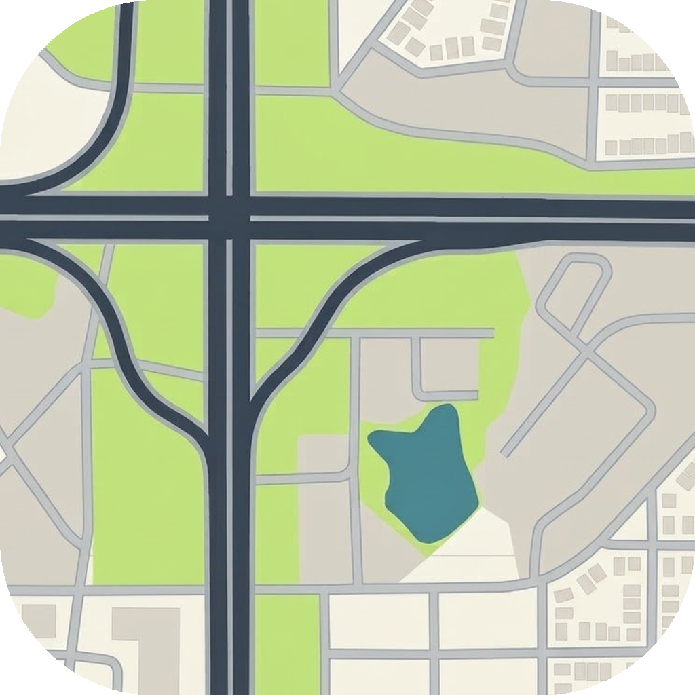

# AutoMap

**Status: work in progress. Debug builds are published on GitHub; no release-signed build exists yet.**

AutoMap is a build of [Vela Maps](https://github.com/PimpinPumpkin/Vela)
for use with the AutoSpace app: an immersive navigation map with new day and
night palettes, 3D buildings, painted highway lanes and road markings, and
smart auto-zoom.

## Repository model — GitHub-native (from 2026-10-27)

**This repo's `main` branch IS the full AutoMap source tree.** Builders push
work commits here, and CI builds releases from that tree. This is the same
model AutoSpace uses.

The earlier slipstream model is retired: a pinned upstream Vela release plus
a patch stack (`automap-patch-stack.diff`) used to be applied in CI. That
patch stack is no longer authoritative and is not in this repo; it is kept
only in local history. Do not apply it on top of this tree — its changes are
already in the tree.

Upstream Vela's workflows are deliberately NOT carried over: their scheduled
data bakes, nightly cuts, and weekly promotions must not run under AutoMap's
name. The only workflow here is the manual-dispatch
`.github/workflows/automap-debug-release.yml`, which builds the debug APK
from this tree and attaches it to a versioned alpha prerelease
(`v0.3.0-alpha.1`, then `.alpha.2`, and so on). The old
`v0.3.0-automap-debug` prerelease is left untouched.

## What AutoMap is

- Package: `app.automap` (internal code namespace stays `app.vela`).
- Display name: AutoMap. Every user-visible mention of Vela becomes AutoMap;
  upstream Vela is credited here and in the app's About screen.
- Licence: GPLv3, same as upstream Vela. See `LICENSE`.
- Upstream base: Vela at commit `85eb69c` ("Reach snapshot for 2026-10-26").
  Future upstream syncs are rebases onto newer upstream commits, made as
  normal commits here, not as a patch stack.
- AutoSpace companion change: AutoSpace adds `app.automap` to its
  navigation-app catalog and prefers it over `app.vela`. AutoMap can coexist
  with upstream Vela on the same phone; lists and routes move by Vela's file
  backup and restore.

## What is built so far

See `PLAN.md` for the original phase-by-phase, build-by-build plan (Builds
0-19, all built), plus the follow-ups after it:

- Builds 0-19: rename to AutoMap, new day and night palettes sampled from
  Google Maps reference screenshots, Automatic / Day / Night and 2D / 3D
  controls, realistic vehicle puck, car nav declutter, bigger traffic lights
  and stop signs, 3D buildings in the car, fade-away buildings on turn
  approach, context auto-zoom, PaintedRoads in the car, lane emphasis at
  splits and exits, overpass and exit emphasis (2D only), destination
  arrival view, terrain hillshade in the car (toggle, off by default), and
  sun-angle building shading.
- Follow-up: sun shading off by default with a first-boot ask to enable it;
  Automatic confirmed as the first-install colour scheme; road-marking
  bakes prepared for Northern Kentucky, Cincinnati metro, and Central
  Kentucky (prepared, not hosted yet — hosting is still undecided).
- Follow-up: top-down realistic 3D Nissan Altima vehicle puck, with a
  settings preview of the same top-down 3D car and a colour picker (hex
  code, colour wheel, and sliders, kept in sync, persisted, applied to the
  puck).
- Follow-up: in-app updater, ported from AutoSpace (Stable / Beta /
  Alpha channels, Alpha default, Updates section in Settings > About,
  once-a-day automatic checks on release builds, manual Check for
  updates, size and SHA-256 checked downloads, system installer).
  Alpha versioning starts here: version 0.3.0-alpha.1, versionCode 2,
  with future alphas bumping both together so the updater can tell a
  new build from the installed one.

In scope: 3D buildings, fade-away buildings, bigger traffic lights and stop
signs, highway lanes, crosswalks and detailed road markings, overpass and
exit emphasis (2D only), smart/dynamic auto-zoom, time-of-day with new day
and night palettes sampled from Google Maps reference screenshots plus
Automatic / Day / Night and 2D / 3D controls, sun-angle building shading, a
realistic vehicle icon, nav declutter in the car, terrain relief in the car
as a toggle off by default, and a destination arrival view (entrance, side
of street, nearby parking).

Out of scope, by decision: trees in any form (including tree icons), true
3D bridges and bridge transparency, full weather simulation, AI landmark
reconstruction, conversational guidance, satellite hybrid in the car for
version one, and "more detailed maps overall" as a standalone item. The icon
also has no arrows.

## Releases and install caveat

Alpha debug builds are attached to versioned prereleases on the Releases
page (starting with `v0.3.0-alpha.1`; the old `v0.3.0-automap-debug`
prerelease is left untouched). There is no release keystore yet, and CI
debug builds are signed with the runner's ephemeral debug keystore,
which changes every run. **A CI debug APK will not install over
any earlier build — uninstall first.** A release keystore, created and
backed up durably before any published release, is still the fix for stable
updates, and in-app updates depend on it. The repo is private, so an
unauthenticated in-app update check cannot read its releases (GitHub
answers 404); the updater reports that as a failure instead of claiming
the app is up to date.

## Icon

The icon is a crop of a real map image: a highway interchange, ramps, grass,
buildings, and a pond, zoomed in and shaped as a UI app icon. No arrows, no
trees, no text.

## Upstream credit

AutoMap is built on Vela Maps by PimpinPumpkin, GPLv3. Map data and place
data downloads in the app continue to come from upstream Vela's hosting
until AutoMap mirrors them. AutoMap has no donation button; upstream
donations are not diverted through this project.
